<p align="center">
  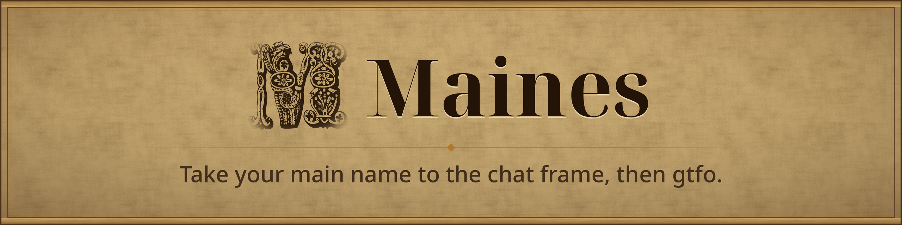
</p>

<p align="center">
  <a href="https://github.com/tuniveza/Maines/releases/latest"></a>
  
  <a href="https://www.curseforge.com/wow/addons/maines"></a>
  
</p>

<p align="center"><em>
You logged in on your bank alt to sell three stacks of linen.<br>
Guild chat says <q>who is this?</q> for the fourth time this week.<br>
Never again.
</em></p>

---

**Maines** pins your main's name to the front of everything you say, so your guild, your friends and
your raid always know who is really talking, whichever alt you are wearing today.

```
[Guild] [Linenseller]: [Tuniveza] anyone up for a key?
```

Set it once. Chat as normal. Get on with your evening.

<p align="center">
  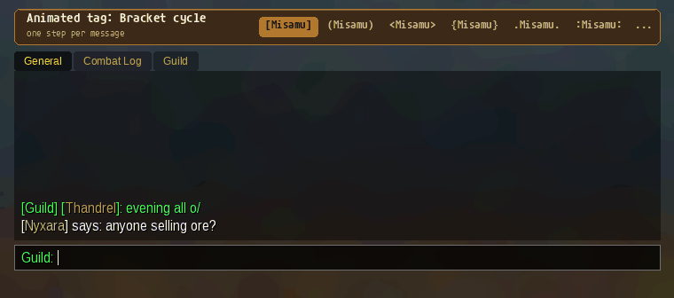
</p>

<h2 align="center">The GLYPH stamp</h2>

Every Maines release gets a name instead of a version number, stamped like a seal on a letter.
**GLYPH** is the one where Maines learned to talk back:

<table align="center">
<tbody>
<tr>
<td>✦ <strong>Animated tag</strong></td>
<td>Your tag shifts a little with every message: bracket cycle, typewriter, capital wave, twinkle, or your own phrases.</td>
</tr>
<tr>
<td>💬 <strong>Saved phrases</strong></td>
<td>One key drops your next saved line into the chat box. Press again for the one after.</td>
</tr>
<tr>
<td>🛡 <strong>Textual Badges</strong></td>
<td>Send a whole picture to chat, one line at a time. Ten come in the box; draw your own.</td>
</tr>
<tr>
<td>🔩 <strong>A new coat of brass</strong></td>
<td>Painted WoW-style icons, thicker fonts, and a textured frame for every palette (renovated in GLYPH.RENOVATION).</td>
</tr>
</tbody>
</table>

Full notes for every stamp: [CHANGELOG.md](CHANGELOG.md).

<h2 align="center">Install</h2>

**CurseForge app:** search for **Maines** and press Install.

**By hand:**
1. Download `Maines-GLYPH.RENOVATION.zip` from the [Releases page](https://github.com/tuniveza/Maines/releases/latest).
2. Unzip it into `World of Warcraft/_retail_/Interface/AddOns/`.
3. You should now have a folder called `AddOns/Maines`.

> Don't use the green **Code → Download ZIP** button.
> That folder is called `Maines-main`, and WoW will ignore it.

<h2 align="center">Quick start</h2>

1. Log in on any character and type `/mains Tuniveza [` (your main's name, then a bracket).
2. Hop to an alt and say something.
3. It goes out as `[Tuniveza] something`.

On your main itself, Maines stays quiet. Nobody needs to be told who you are when you are you.
(Change that with `/mainshow`.)

Prefer buttons? Type **`/maines`** or left-click the brass **M** on your minimap.

<h2 align="center">The workshop</h2>

<p align="center">
  
</p>

Every page of the window does exactly what the slash commands do. Use whichever you like, or mix both.

<table align="center">
  <tr>
    <td align="center" width="50%">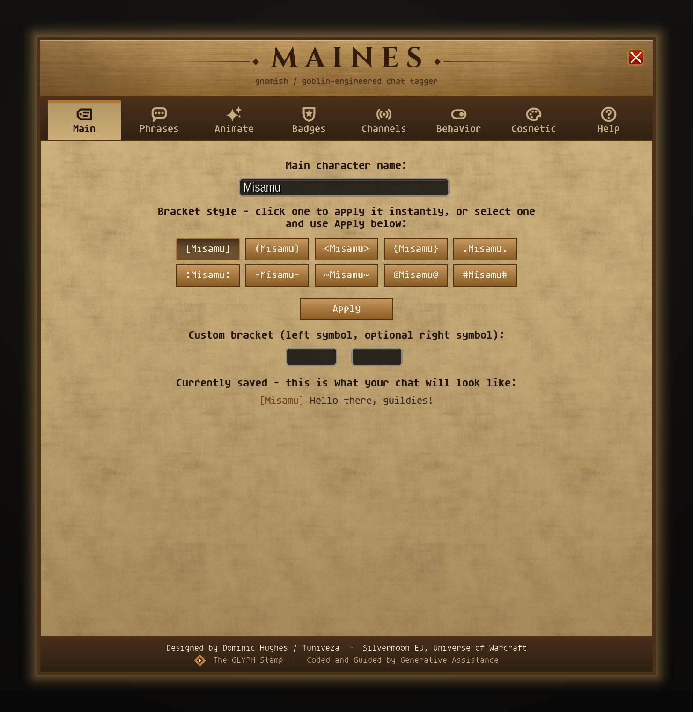<br><sub><b>Main</b> · name and brackets, previewed live</sub></td>
    <td align="center" width="50%">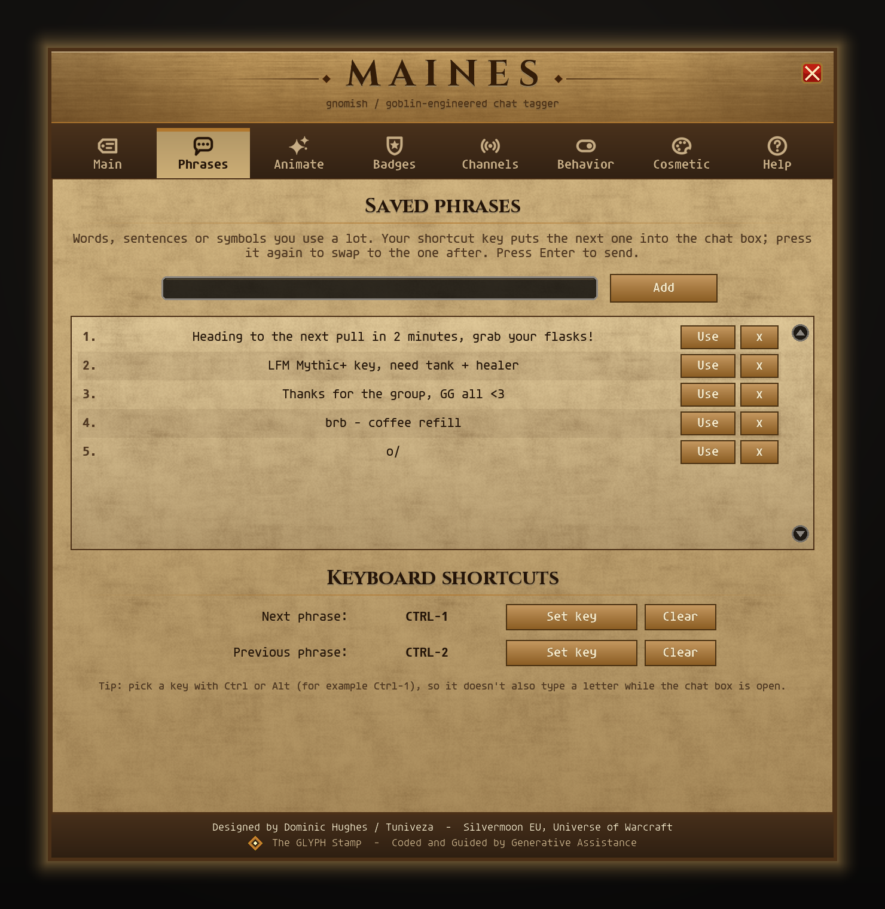<br><sub><b>Phrases</b> · your lines, your keys</sub></td>
  </tr>
  <tr>
    <td align="center">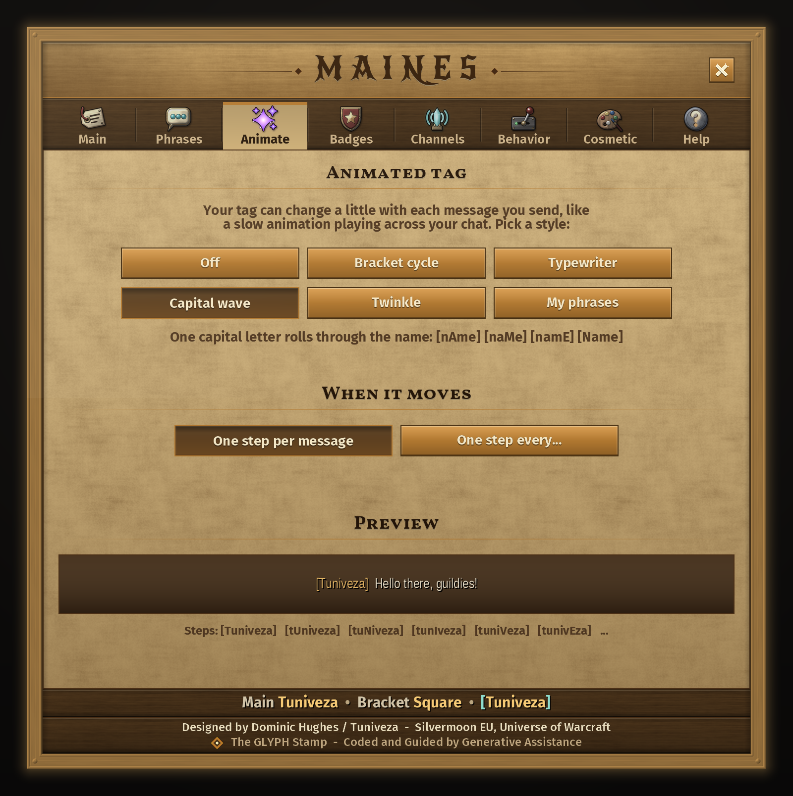<br><sub><b>Animate</b> · how your tag moves</sub></td>
    <td align="center">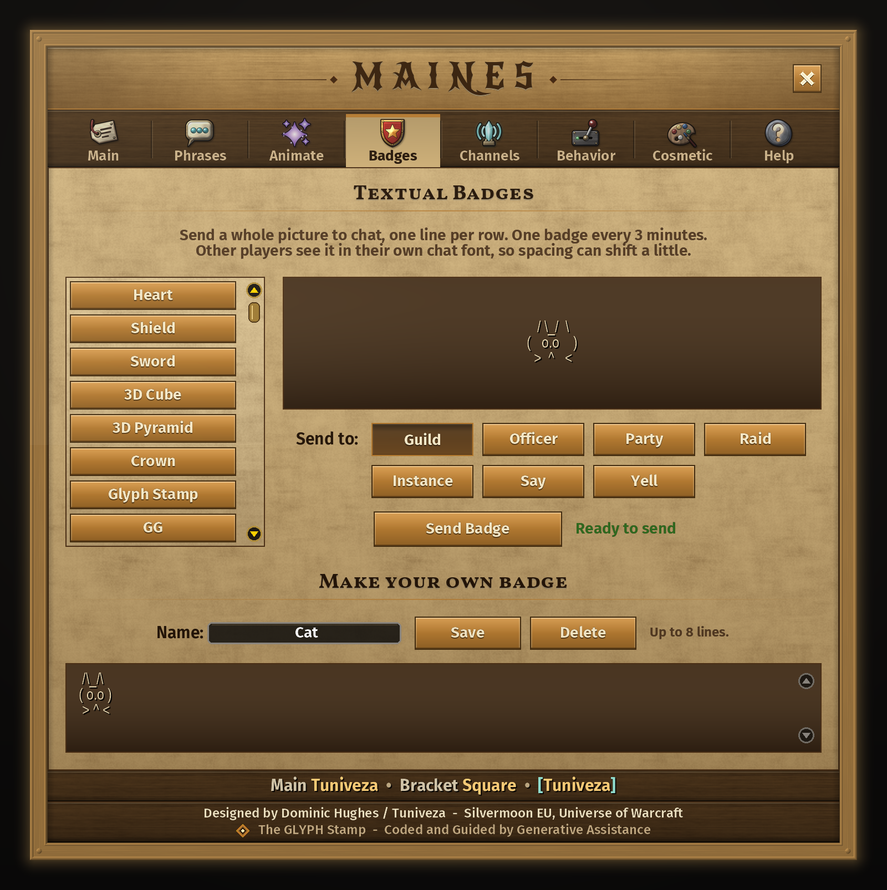<br><sub><b>Badges</b> · pick, preview, draw, send</sub></td>
  </tr>
  <tr>
    <td align="center">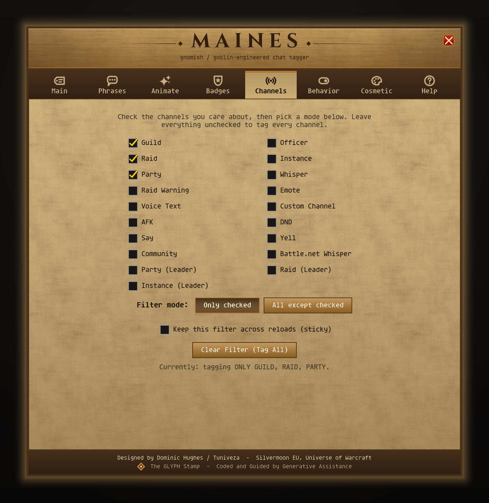<br><sub><b>Channels</b> · where the tag goes</sub></td>
    <td align="center">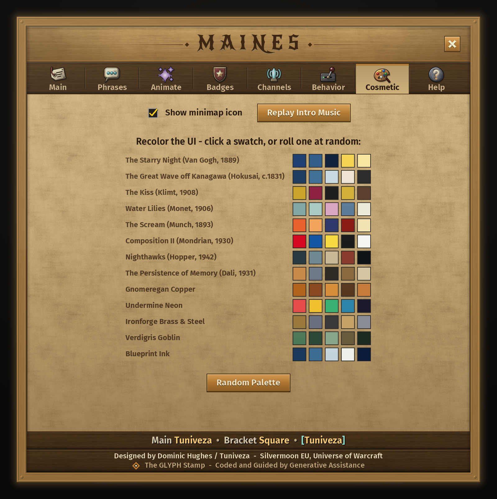<br><sub><b>Cosmetic</b> · paint the brass</sub></td>
  </tr>
</table>

<sub>Window pictures are rendered offline from the addon's real UI code (its own layout, colours, textures and font), not captured in game.<br>
The icons, textures and frames were made with generative assistance (the generators are in <code>tools/</code>); they were not hand-drawn.</sub>

<h2 align="center">Saved phrases</h2>

Keep the things you say every night on a key: `LF1M`, `ty for the group!`, `gz`, or a row of symbols you can never remember how to type.

<p align="center">
  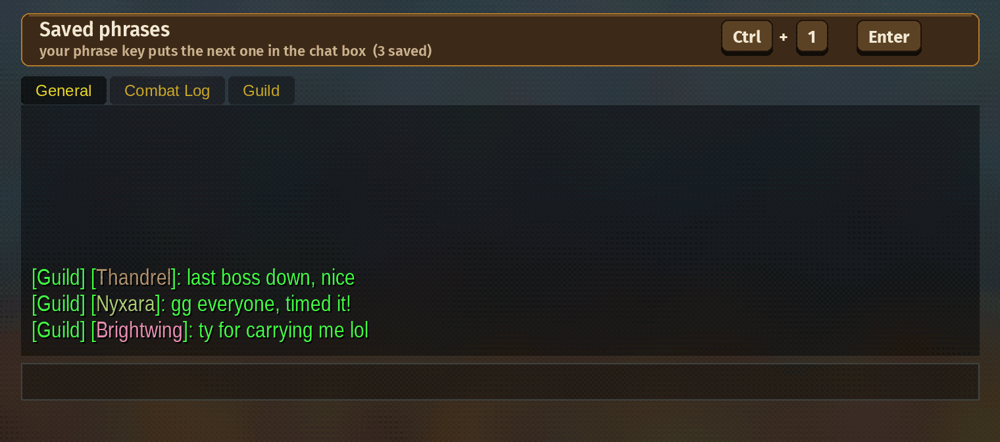
</p>

1. Add a phrase: `/mainphrase add ty for the group!` (or use the **Phrases** page).
2. Set your key: **Phrases** page, or **Key Bindings → AddOns → Maines**.
3. Press the key in chat. Press it again to swap. Press **Enter** to send.

Maines never sends anything for you. You always press Enter yourself.

<h2 align="center">Animated tag</h2>

Your name, but restless. One step per message, or one step every 30 seconds to 15 minutes.

<table align="center">
<thead>
<tr>
<th>Style</th>
<th>What your guild sees, message by message</th>
</tr>
</thead>
<tbody>
<tr>
<td>Bracket cycle</td>
<td><code>[Tuniveza]</code> → <code>(Tuniveza)</code> → <code>&lt;Tuniveza&gt;</code> → <code>{Tuniveza}</code></td>
</tr>
<tr>
<td>Typewriter</td>
<td><code>[Z]</code> → <code>[Zu]</code> → <code>[Zun]</code> → … → <code>[Tuniveza]</code></td>
</tr>
<tr>
<td>Capital wave</td>
<td><code>[tUniveza]</code> → <code>[tuNiveza]</code> → <code>[tunIveza]</code> → … → <code>[Tuniveza]</code></td>
</tr>
<tr>
<td>Twinkle</td>
<td><code>[Tuniveza *]</code> → <code>[Tuniveza +]</code> → <code>[Tuniveza x]</code> → <code>[Tuniveza +]</code></td>
</tr>
<tr>
<td>My phrases</td>
<td>your tag, then your next saved phrase</td>
</tr>
</tbody>
</table>

Pick one on the **Animate** page, or `/mainanim typewriter`. `/mainanim off` keeps it still.

<h2 align="center">Textual Badges</h2>

Why say *gg* when you can send a five-line **GG** carved in text?

<p align="center">
  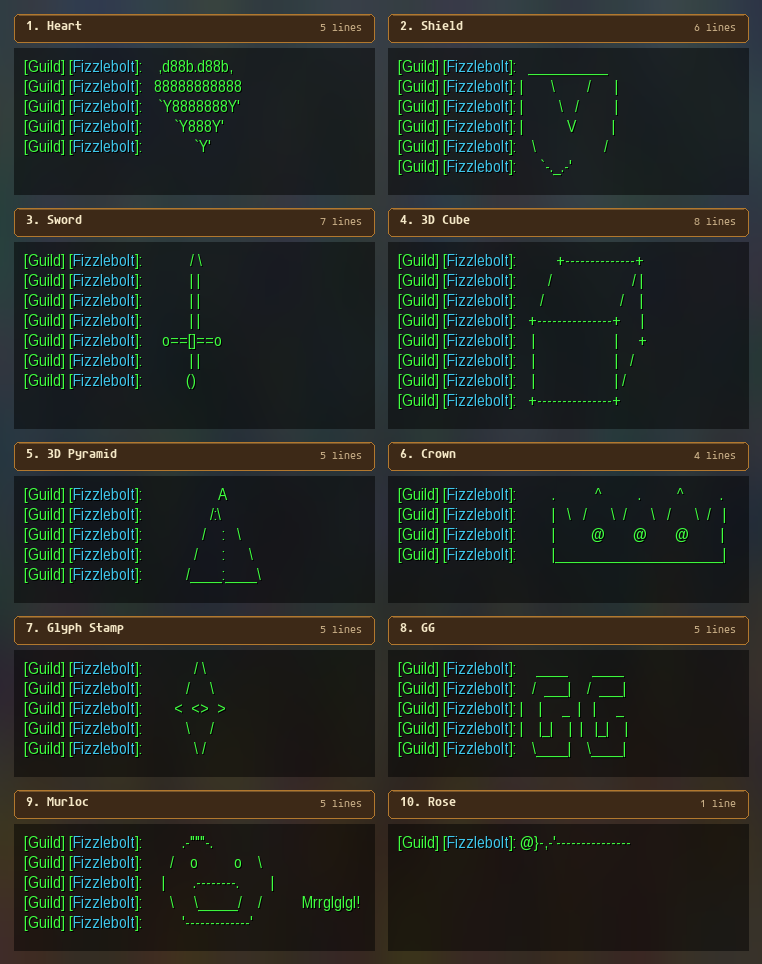
</p>

Ten come in the box: **Heart, Shield, Sword, 3D Cube, 3D Pyramid, Crown, Glyph Stamp, GG, Murloc** and **Rose**.
Draw and save your own on the **Badges** page.

- `/mainbadge` lists them.
- `/mainbadge show 8` previews one, only for you.
- `/mainbadge send 8 guild` sends it.

One badge every 3 minutes. Your guild will thank you. Mostly.

<h2 align="center">Paint the brass</h2>

`/maincolor` (or right-click the minimap button) repaints the whole window from one of 13 palettes.
Some come from famous paintings: *The Starry Night*, *The Great Wave*, *The Kiss*, *Nighthawks*, *The Scream* and more.
Some come from closer to home: *Gnomeregan Copper*, *Undermine Neon*, *Ironforge Brass & Steel*, *Verdigris Goblin*.
Each palette brings its own paper texture and its own frame: riveted brass, gilded mosaic, weathered copper, neon tubing and more.
It colours the title bar, tab bar and footer too, and Maines remembers your pick after a `/reload`.

Pick a swatch yourself on the **Cosmetic** page. The reading text always stays readable, whatever you roll.

<p align="center">
  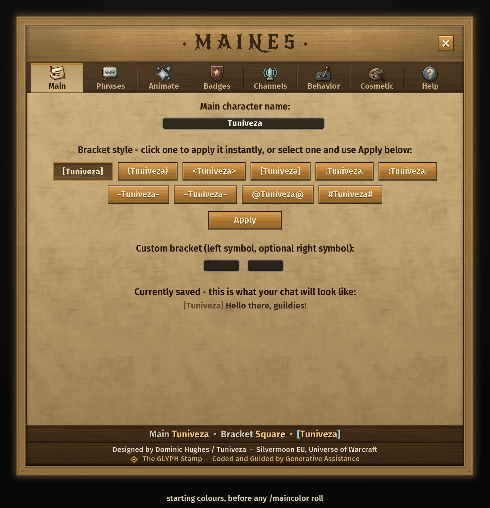
</p>

<h2 align="center">Commands</h2>

<table align="center">
<thead>
<tr>
<th>Command</th>
<th>What it does</th>
</tr>
</thead>
<tbody>
<tr>
<td><code>/mains &lt;name&gt; &lt;bracket&gt;</code></td>
<td>Set your main and bracket: <code>/mains Tuniveza (</code>, <code>/mains Tuniveza *</code>, <code>/mains Tuniveza &lt;&lt; &gt;&gt;</code></td>
</tr>
<tr>
<td><code>/main</code></td>
<td>Show what's set</td>
</tr>
<tr>
<td><code>/maines</code></td>
<td>Open the window</td>
</tr>
<tr>
<td><code>/mainhide</code> · <code>/mainshow</code></td>
<td>Stay quiet on your main (default) · always tag</td>
</tr>
<tr>
<td><code>/mainchat</code></td>
<td>Choose channels: <code>SAY,GUILD</code>, <code>+WHISPER</code>, <code>-SAY,-YELL</code>, <code>list</code>, <code>mode exclude</code>, <code>sticky</code></td>
</tr>
<tr>
<td><code>/mainphrase</code></td>
<td><code>add &lt;text&gt;</code>, <code>del &lt;n&gt;</code>, <code>list</code>, <code>clear</code>, <code>next</code>, <code>prev</code></td>
</tr>
<tr>
<td><code>/mainanim</code></td>
<td><code>&lt;style&gt;</code>, <code>message</code>, <code>time &lt;seconds&gt;</code></td>
</tr>
<tr>
<td><code>/mainbadge</code></td>
<td><code>list</code>, <code>show &lt;n&gt;</code>, <code>send &lt;n&gt; [channel]</code></td>
</tr>
<tr>
<td><code>/maincolor</code></td>
<td>Roll a new painting palette</td>
</tr>
<tr>
<td><code>/mainmap</code></td>
<td>Show or hide the minimap button</td>
</tr>
<tr>
<td><code>/bracket</code></td>
<td>List the built-in bracket styles</td>
</tr>
<tr>
<td><code>/mainhelp</code></td>
<td>Every command, with examples, in a window (<code>/mainhelp text</code> prints to chat)</td>
</tr>
<tr>
<td><code>/mainnote</code></td>
<td>What's new in this stamp</td>
</tr>
<tr>
<td><code>/mainstamp</code></td>
<td>Which stamp you're running</td>
</tr>
<tr>
<td><code>/maindebug</code></td>
<td>Explain every tagging decision as you type</td>
</tr>
</tbody>
</table>

**Minimap button:** left-click opens the window · right-click repaints it · middle-click clears your channel filter · drag to move.

<details>
<summary><b>More about channels</b></summary>

By default every channel is tagged: say, yell, emote, party, raid, raid warning, instance, guild, officer,
whispers, Battle.net whispers, channels and Communities (all of them, not just the first one).

- `/mainchat SAY,GUILD` tags only those.
- `/mainchat mode exclude` flips it: tag everything **except** the listed channels.
- Case and spaces don't matter: `say, guild` works.
- Filters reset to "tag everything" on `/reload` unless you turn on `/mainchat sticky`.
  This stops a forgotten filter from silently hiding your tag for weeks.

Another addon already tags your whispers? `/mainchat -WHISPER`.

Valid names: `SAY`, `YELL`, `EMOTE`, `PARTY`, `PARTY_LEADER`, `RAID`, `RAID_LEADER`, `RAID_WARNING`,
`INSTANCE_CHAT`, `INSTANCE_CHAT_LEADER`, `GUILD`, `OFFICER`, `WHISPER`, `BN_WHISPER`, `CHANNEL`,
`COMMUNITIES_CHANNEL`, `VOICE_TEXT`, `AFK`, `DND`.
</details>

<details>
<summary><b>Tag not showing up?</b></summary>

1. Type `/main` and check your name is set.
2. Are you on your main? Maines stays quiet there unless you `/mainshow`.
3. Type `/mainchat list`. A forgotten filter may be skipping that channel. `/mainchat` alone clears it.
4. Still stuck? Type `/maindebug`, say something, and send the lines it prints with your
   [bug report](https://github.com/tuniveza/Maines/issues).
</details>

<details>
<summary><b>For developers</b></summary>

- **Tests:** `tests/run.sh` runs Maines offline under Lua 5.1 against a mocked WoW API (`tests/wowmock.lua`).
- **Pictures:** `tools/` rebuilds the icons, textures and the README media from the real UI code.
- **Releasing:** push an annotated tag named after the stamp (`git tag -a GLYPH -m GLYPH && git push origin GLYPH`). Revisions of a stamp add a word, not a number: `GLYPH.RENOVATION`.
  [BigWigsMods/packager](https://github.com/BigWigsMods/packager) (`.github/workflows/release.yml`) builds
  `Maines-<stamp>.zip` using `.pkgmeta`, publishes the GitHub release and uploads to CurseForge.
  Player-facing notes come from `CHANGELOG.md`; the CurseForge page text lives in `docs/curseforge-description.md`.
- **How tagging works on Midnight:** patch 12.0 rebuilt outgoing chat, which silently broke the old
  `SendChatMessage` hook. Maines now edits the chat box text in the `ChatFrame.OnEditBoxPreSendText`
  callback, just before Blizzard reads it, with a `ChatEdit_SendText` hook kept for Classic.
  Community chat is detected by the edit box's `clubId`, because Blizzard doesn't always mark it as
  `COMMUNITIES_CHANNEL`.
- Built on Ace3 (AceAddon, AceHook) with LibDataBroker and LibDBIcon. Text is set in
  [New Rocker](https://fonts.google.com/specimen/New+Rocker) (titles),
  [Vollkorn SC](https://fonts.google.com/specimen/Vollkorn+SC) (headings) and
  [Fira Sans](https://fonts.google.com/specimen/Fira+Sans) (text, buttons and text boxes), all under the
  SIL Open Font License 1.1 (licence files in `fonts/`).
</details>

<h2 align="center">Author</h2>

Made by **Zuniversa / Tuniveza** (Dominic Hughes) · EU Silvermoon.
Say hi in game. You'll know it's me: the tag gives it away.
